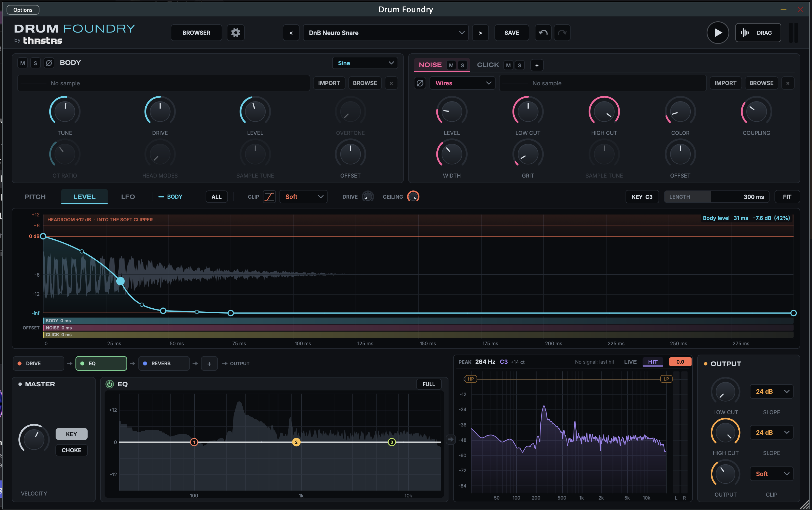

# Drum Foundry VST

[](https://github.com/donjmilligan/drum-foundary/releases/latest)

**Version 0.1.1**, by Theres Tears Records. See [Releases](https://github.com/donjmilligan/drum-foundary/releases) for the installers.



A kick and snare synthesizer plugin in the spirit of drum synths like Sonic Academy's Kick 3, Plugin Boutique's BigKick, D16 Group's Punchbox and Sonic Charge's Microtonic (see [Trademarks](#trademarks)). You draw the pitch and amplitude envelopes directly over the rendered waveform, and build the sound from layers. Each layer can be synthesized or play a sample you import.

- **Body**: the tonal drum head. It follows the drawn **pitch** curve and **body** level curve. The style menu is grouped into **Kick** (Kick and the kick bodies), **Snare** (Classic, Membrane, Wood), **Kick or Snare** (808, 909, FM), **Basic** waveforms, and Sample. Pick a style:
  - **Classic**: sine, then triangle, then square, with an overtone and head modes.
  - **Membrane**: a modal snare or tom head.
  - **Wood**: a wooden shell and head. A resonator at the fundamental and eight damped wood modes (measured from wood snares, 1.6 to 5.8 times the fundamental), struck by a stick with a little grain. **Hardness** shortens the strike and brightens it, **Knock** sets the wood modes' level, **Spread** stretches them, and **Damping** goes from ringing to a dead, dry knock. Presets: FG Wood Snare, FG Wood Crack, FG Rim Ring and FG Knock Room.
  - **808** and **909**: analog-style snare and kick circuits.
  - **Kick**: a sine sweep with a saturation that fades out.
  - **FM**: two-operator FM.
  - Kick bodies, each with a factory preset that draws the tail shape that suits it:
    - **Round**: a sine saturated into fat, rounded tops that stay full for the whole tail. **Warmth** makes it fuller on one side. Preset: Rounded Kick, a tail that holds and then rolls off.
    - **Taper**: pointed peaks (sine, then triangle, then narrow spikes) that ease back to a sine. **Taper** sets how fast. Presets: Tapered Kick, a tail that thins from the start, and Psy Kick, the psytrance "fishtail" (a snappy front, a short duck, then the boom, an eighth note at 145 BPM).
    - **Hard**: up to ~30 dB of clipping into a sustained, squared-off tail. **Bark** adds a partial before the clipper and **Crunch** is a second clipping stage. Presets: Hardstyle Kick and Gabber Kick.
    - **Fold**: a sine wavefolder whose folds can open out over the hit (**Fold Decay**). Preset: Folded Techno Kick.
    - **Tonal**: a sine plus harmonics 2–8, with **Bright**, **Stretch** (x2 = exact harmonics) and **Harm Decay**. Preset: Tonal Kick.
  - Basic waveforms, neither kick nor snare, that follow the curves like the rest (Saw and Square are band-limited, so fast sweeps don't alias):
    - **Sine**, with **Drive** (soft saturation).
    - **Saw**, starting from 0 mid-ramp, with **Drive**.
    - **Square**, with **Width** (pulse width, 50% down to 10%). It fades in over 0.5 ms so the hit doesn't start with a click.
    - **Round Square**: a square with rounded corners. **Corner** sets how sharp they are.
    - **Triangle**, with **Skew** (symmetric, leaning towards a saw).
  - **Sample**: an imported one-shot.
- **Noise**: the snare wires. It follows the drawn **noise** curve, through low-cut and high-cut filters. Styles are **Wires** (noise that the body modulates, like wires on the bottom head), **White**, **Pink**, **Metallic** (808-style square-wave cluster), **Crackle**, and **Sample**.
- **Click**: the transient, as its own layer. Types are Tick, Snap, Stick, Rim, Pop, **Beater** (for kicks), **Clap** (3 or 4 noise bursts and a short tail), the modelled impacts below, or **Sample**.
  - The modelled impacts sound like something being hit rather than a synthetic spike. A beater or stick makes contact for 0.1–1 ms, bounces, and its reflections ring a set of resonances. A short snap and a noise texture darken as they decay, and every hit varies a little. They were tuned against measurements of about 600 recorded kick clicks and rims: their rise (1–6 ms), how fast they darken, how long each band rings, and their resonances. **Tone** is the main resonance, and a higher Tone also hardens the contact. **Length** scales every decay, and 8 ms gives the material as measured.
    - **Felt**: a soft kick beater, a knock around 0.9 kHz over a low thump.
    - **Plastic**: a hard beater, a bright ting around 7 kHz over a low knock.
    - **Skin**: the top end of a miked acoustic kick, one clear snap and a bright ring.
    - **Wood**: a stick on a rim or block.
    - **Tok**: the hardstyle tok, a pitched resonant knock.
- **LFOs**: three, on their own tab. Drag one onto any knob to modulate it.
- **Extra layers**: up to three more layers. Each can be another **Body** (any synthesised style), **Noise** or **Click** layer, or a **Sample** or **Sine** sub. Each has its own pitch and level curves, and each one can instead be coupled to the Body, Noise or Click curve, or set to Flat. It also has its own level, tune, offset, low and high cut, and pan. There's only one Body.
- **Effects chain**: the strip under the display holds the effects in signal order. Drag a module to move it, click its light to switch it on or off, use × (or right-click) to take it out, and use **+** to add one. Click a module to show its controls in the panel below. Each module can be used once: **Drive** and **Drive 2** (2× oversampled Soft, Hard, Tube, Fold or Crush), the **EQ** (8 bands; its panel has a small version of the EQ's graph: drag a node for frequency and gain, scroll for Q, and **FULL** or a double-click opens the whole EQ), **Comp** and **Comp 2**, **Clip** and **Clip 2** (Soft, Hard, Tube, Tape or Fold, with Drive and Ceiling), and the gated **Reverb**. So you can compress and then clip, clip and then compress, or catch the peaks with one clipper, glue with a compressor and clip again at the end. The default chain is Drive → EQ → Reverb, which is what every older session and preset gets. The order is saved with the patch, and undo covers it. Changing it during playback fades out, switches and fades back in over about 20 ms, with no click. A compressor's chip shows its gain reduction as it works.
  - **Compressor**: **Threshold**, **Ratio**, **Attack** (0.1 to 100 ms), **Release**, **Knee**, **Makeup**, **Mix** (below 100% is parallel compression) and **Style**. It's stereo-linked, with no look-ahead or latency. A slow attack (10–30 ms) lets a drum's transient through and clamps the body, which exaggerates the snap. A fast one catches the transient. Over the knobs, the panel shows what the compressor does to the hit: the waveform going in (grey), coming out (in colour), and the gain reduction hanging from the top, redrawn as you turn a knob. Hover it to read the reduction at any moment.
  - **Style** models a classic compressor's behaviour: its detector, its timing and its gain cell. In every style the steady-state ratio is the Ratio knob's.
    - **Clean** is transparent and feed-forward.
    - **FET** works like a 1176. Its detector hears the output (feedback), its attack goes down to about 25 µs, its knee firms up at high ratios, and it adds odd-harmonic grit as it digs in (around 1% at 20 dB of reduction).
    - **Opto** works like an LA-2A. It's an optical cell with an attack no faster than about 3 ms and a two-stage release: half lets go fast, and half lets go slowly, slower still the longer and harder it has been compressing. It has a wide knee and a little even-harmonic warmth.
    - **Bus** works like an SSL bus compressor. It's a feed-forward VCA with a firm knee and an auto release: quick after a single hit, slow under sustained level, so it glues rather than pumps.
    - **Punch** works like a dbx 160. It has an RMS detector, a wide "over easy" knee, an attack that speeds up the harder it's hit, and a release at a constant rate in dB per second (120 dB/s at a 120 ms Release), which makes for snappy drums.

    The output compressor has the same Style menu, in the Level tab's header. These are our own models, written from how the hardware works and from the published design literature (Giannoulis, Massberg and Reiss, "Digital Dynamic Range Compressor Design: A Tutorial and Analysis", JAES 2012). No code from other compressor plug-ins is included.
- **Output**: after the chain come a final **output low-cut and high-cut** (12, 24 or 48 dB/oct; each goes across the whole analyzer, 20 Hz to 20 kHz, so the high cut can go all the way down and the low cut all the way up), output gain, and the output stage, which the display's Level tab shows. The output stage is a clipper (**Soft**, **Hard**, **Tube**, **Tape** or **Fold**, with its own **Drive**, 0 to 24 dB into the clipper, and **Ceiling**, -12 to 0 dBFS), **Comp** (an output compressor: Threshold, Ratio, Attack, Release and Makeup, set from the Level tab's header), or **Off**, which lets the output go over 0 dBFS. The plug-in's latency is fixed: it doesn't change with the chain's order or with what's in it, and it's the same in every output mode. It's 98 samples at 44.1 kHz, 101 at 48 kHz (about 2.1 ms) and 86 at 96 kHz. That covers both Drives' oversamplers and all three clippers (each runs 8× oversampled, 4× at 88.2/96 kHz), whether or not they're in use.
- **Spectrum analyzer**: shows the audio leaving the plugin, with the output filter curve, draggable low-cut and high-cut handles, a readout of the loudest frequency and its note, and a L/R meter. Its **HIT** mode shows the spectrum of the rendered hit without playing it.
- **Sample browser**: browses and searches your sample folders, starting at the Ableton User Library. Click a file to audition it, and double-click or drag it onto a layer to load it.

It builds as VST3, AU and Standalone on macOS, and as VST3 and Standalone on Windows (JUCE 8, CMake).

## Download

Ready-made installers for macOS and Windows go on the [Releases page](https://github.com/donjmilligan/drum-foundary/releases) when a release is made. If there isn't one there yet, [build it yourself](#build). Open the newest release and, under **Assets**, download the file for your system.

The installers aren't signed with an Apple or Microsoft certificate, so both systems warn you the first time. The steps below get past that.

### macOS

Download `DrumFoundry-<version>-macOS.pkg`. It's one installer for Apple Silicon and Intel Macs running macOS 11 (Big Sur) or later, and it installs:

- the VST3, `Drum Foundry.vst3`, into `/Library/Audio/Plug-Ins/VST3`
- the AU, `Drum Foundry.component`, into `/Library/Audio/Plug-Ins/Components`
- the standalone app, `Drum Foundry.app`, into `/Applications`
- the licence texts, into `/Library/Application Support/Drum Foundry/Licenses`

To leave out the VST3, the AU or the app, click **Customize** in the installer and untick it.

The first time you open the .pkg, macOS blocks it because it isn't signed. On macOS 15 (Sequoia) or later, click **Done**, open **System Settings ▸ Privacy & Security**, scroll down to the message about the installer, and click **Open Anyway**. On older macOS, right-click the .pkg, choose **Open**, then click **Open** again.

After installing, open your DAW and rescan plug-ins. Drum Foundry is an instrument, from Theres Tears Records. If a DAW doesn't show the AU, run `killall -9 AudioComponentRegistrar` in Terminal, then rescan or restart the DAW.

### Windows

Download `DrumFoundry-<version>-Windows-Setup.exe` (64-bit Windows 10 or 11) and run it. It installs:

- the VST3, `Drum Foundry.vst3`, into `C:\Program Files\Common Files\VST3`
- the standalone app into `C:\Program Files\Drum Foundry`, with a Start-menu shortcut
- the licence texts into the `Licenses` folder there

If Windows says **Windows protected your PC**, click **More info**, then **Run anyway**. After installing, open your DAW and rescan plug-ins. To uninstall, go to **Settings ▸ Apps**, find Drum Foundry and click **Uninstall**.

*Making the installers yourself:* on a Mac, `packaging/macos/make-pkg.sh` builds a universal Release and writes the .pkg to `installers/Mac/`. It's unsigned unless you set the Developer ID variables described at the top of the script. The Windows installer is built on Windows with [Inno Setup](https://jrsoftware.org/isinfo.php) 6.3 or later, after a Release build into `build\` (see [Build](#build)): run `ISCC /DAppVersion=0.1.1 packaging\windows\DrumFoundry.iss`, using the version from `CMakeLists.txt` (without it the installer is labelled 0.0.0). The installer goes to `installers\Windows\`. `installers/` isn't kept in the repository: every CI run keeps the installers (and a zip of the bare Windows VST3) as downloadable artifacts, and each release attaches them on the Releases page.

*For developers:* a release is made by pushing a tag `vX.Y.Z` that matches the version in `CMakeLists.txt` (`project(DrumFoundry VERSION X.Y.Z ...)`) and the **Version X.Y.Z** line at the top of this README (CI fails if the README line doesn't match). The GitHub Actions workflow then builds both installers, plus the Windows VST3 zip, and attaches them to a new release.

## Build

You can also build Drum Foundry yourself. It takes three commands once the tools are installed. The first build takes about 5 to 15 minutes, and later builds are much quicker. The steps below build the plug-in and the standalone app. Developers who also want the dev tool can leave out `-DDRUMFOUNDRY_BUILD_TOOLS=OFF` (see [Dev tool](#dev-tool)).

JUCE 8.0.15, the framework Drum Foundry is built on, lives in `libs/JUCE`. If that folder is empty (a fresh clone, or a ZIP downloaded from GitHub), CMake downloads JUCE 8.0.15 by itself the first time you configure, so you need an internet connection and Git for that step.

### macOS

You need macOS 11 (Big Sur) or later, on an Apple Silicon or Intel Mac. The full Xcode app is not needed.

1. **Install the Xcode Command Line Tools** (the compiler, and Git). Open Terminal (Applications ▸ Utilities) and run:

   ```sh
   xcode-select --install
   ```

   Click **Install** in the window that appears. If it says the tools are already installed, carry on.

2. **Install CMake and Ninja.** The easiest way is [Homebrew](https://brew.sh): install it with the command on its home page, then run:

   ```sh
   brew install cmake ninja
   ```

   Check that both work: `cmake --version` must say 3.22 or later, and `ninja --version` must print a version number.

3. **Get the source code**, and move into its folder:

   ```sh
   cd ~/Documents
   git clone https://github.com/donjmilligan/drum-foundary.git
   cd drum-foundary
   ```

   (Or click **Code ▸ Download ZIP** on GitHub, unzip it, and `cd` into the unzipped folder.)

4. **Configure:**

   ```sh
   cmake -S . -B build -G Ninja -DCMAKE_BUILD_TYPE=Release -DDRUMFOUNDRY_BUILD_TOOLS=OFF
   ```

   This builds for the kind of Mac you're on. To build one copy that runs on both Apple Silicon and Intel Macs, add `-DCMAKE_OSX_ARCHITECTURES="arm64;x86_64"`.

5. **Build:**

   ```sh
   cmake --build build
   ```

6. **Use it.** The build installs the plug-ins for you, into `~/Library/Audio/Plug-Ins/VST3` (Drum Foundry.vst3) and `~/Library/Audio/Plug-Ins/Components` (Drum Foundry.component, the AU). Open your DAW and rescan plug-ins. Drum Foundry is an instrument, from Theres Tears Records. The standalone app is in `build/DrumFoundry_artefacts/Release/Standalone/`, and you can drag it into Applications.

To update later, run `git pull` in the `drum-foundary` folder, then step 5 again.

**If something goes wrong:**

- *A DAW doesn't show the AU, or shows an old version:* run `killall -9 AudioComponentRegistrar`, then rescan or restart the DAW. Logic Pro checks AUs on its first scan. Its Plug-in Manager (Logic Pro ▸ Settings ▸ Plug-in Manager) can reset and rescan one.
- *`cmake: command not found`:* Homebrew isn't on your PATH. Run the two `echo … >> ~/.zprofile` lines Homebrew printed at the end of its install, then open a new Terminal window.
- *Something failed and you want a clean start:* delete the `build` folder (`rm -rf build`) and go back to step 4.

**Copying your build to another Mac:** a plug-in you built yourself loads on your own Mac without warnings. On another Mac, macOS blocks it, because it isn't signed with an Apple Developer ID. On that Mac, copy the plug-ins into the same folders and run `xattr -dr com.apple.quarantine ~/Library/Audio/Plug-Ins/VST3/"Drum Foundry.vst3" ~/Library/Audio/Plug-Ins/Components/"Drum Foundry.component"` to clear the block. If that Mac has a different chip from yours, build with the universal option in step 4.

### Windows

You need 64-bit Windows 10 or 11. Windows has no AU format, so you get the VST3 and the standalone app.

> The Windows build is new. If it fails, please open an issue on GitHub and paste the error message.

1. **Install Visual Studio** (2022 or newer). The free **Community** edition is fine: download it from [visualstudio.microsoft.com](https://visualstudio.microsoft.com/downloads/). In the installer, tick the **Desktop development with C++** workload and click Install. That workload includes the compiler, CMake and Ninja, so you don't need to install them separately. If you don't want the editor, the smaller **Build Tools for Visual Studio** with the same workload works too.

2. **Install Git** from [git-scm.com](https://git-scm.com/download/win). The default options are fine.

3. **Open the build prompt.** In the Start menu, search for **x64 Native Tools Command Prompt** and open it. (It's in the Visual Studio folder. Use this one, not the plain Command Prompt or PowerShell, because it sets up the compiler. Make sure it says **x64**.)

4. **Get the source code**, and move into its folder:

   ```bat
   cd %USERPROFILE%\Documents
   git clone https://github.com/donjmilligan/drum-foundary.git
   cd drum-foundary
   ```

5. **Configure:**

   ```bat
   cmake -S . -B build -G Ninja -DCMAKE_BUILD_TYPE=Release -DDRUMFOUNDRY_BUILD_TOOLS=OFF
   ```

6. **Build:**

   ```bat
   cmake --build build
   ```

7. **Install the VST3.** The build makes a folder called `Drum Foundry.vst3` in `build\DrumFoundry_artefacts\Release\VST3\`. Copy that whole folder into `C:\Program Files\Common Files\VST3\`. In File Explorer, Windows asks for administrator permission, so click Continue. Or, from a command prompt opened with **Run as administrator**:

   ```bat
   xcopy /E /I /Y "build\DrumFoundry_artefacts\Release\VST3\Drum Foundry.vst3" "C:\Program Files\Common Files\VST3\Drum Foundry.vst3"
   ```

   (To have every build install itself instead, open the x64 Native Tools Command Prompt with **Run as administrator** and add `-DDRUMFOUNDRY_COPY_PLUGINS=ON` to step 5.)

8. **Use it.** Open your DAW and rescan plug-ins. In Ableton Live, that's Options ▸ Preferences ▸ Plug-ins: turn on **Use VST3 Plug-in System Folders** and click Rescan. The standalone app is `build\DrumFoundry_artefacts\Release\Standalone\Drum Foundry.exe`.

To update later, run `git pull` in the `drum-foundary` folder, then steps 6 and 7 again.

**If something goes wrong:**

- *`'cmake' is not recognized` or `No CMAKE_CXX_COMPILER could be found`:* you're in the wrong prompt. Open **x64 Native Tools Command Prompt** (step 3).
- *Errors about `x86`, or a plug-in that the DAW won't load:* the prompt was the x86 one. Delete the `build` folder (`rmdir /S /Q build`), open the **x64** prompt, and start again from step 5.
- *`Permission denied` while copying to `Common Files\VST3`:* the prompt isn't running as administrator. See step 7.

On Windows, user presets are saved in `Music\Drum Foundry\Presets`, DRAG exports go to `Music\Drum Foundry\Exports`, and the sample browser looks for the Ableton library in `Documents\Ableton`.

## Using it

- **Display:** double-click to add a point, and double-click (or right-click) a point to remove it. Drag a segment's midpoint handle to bend that segment. Shift-drag gives fine vertical control. Scroll or pinch to zoom the time axis, and **FIT** resets the zoom.
- **Length** stretches all three envelopes together.
- **Envelopes:** the display has two tabs, **PITCH** and **LEVEL**. Every layer has its own pitch and level curve, and the display shows the curve of the layer you select above: a click anywhere on the Body panel or a Layers tab (its knobs and menus included) brings that layer's curves up, even from the LFO tab. Its name is shown next to the tabs, in the layer's colour. **ALL**, next to the name, shows every layer's curve on the tab together (all the pitch curves, or all the level curves), the others dimmed and named. A switched-off layer is dashed and marked (OFF). Click a dimmed one to edit it (the Layers panel follows). ALL is remembered with the session. For an extra layer, the menu next to its name sets where the curve on that tab comes from: **OWN** (its own curve), **BODY**, **NOISE** or **CLICK** (coupled to that layer's curve, so editing it from either tab changes both), or **FLAT** (full level, or no pitch movement). Pitch and Level are set separately. Switching from a coupled curve to OWN starts the layer's own curve as a copy of it, so the sound doesn't jump. A new layer starts on its own curves, copied from the Body (Body, Sine), the Noise layer (Noise) or flat (Click; Sample gets the Body's level). Sessions and presets saved before this keep their sound: their layers come back coupled the way they played.
- **Pitch curve:** the Pitch tab shows absolute pitch from **0 Hz** to 16 kHz, on a log-like scale (log2(1 + f/20 Hz)). **FOCUS** starts fully left (the whole range) and zooms into a band around the curve. Drag the ruler or alt-scroll to pan. Every pitch curve ends on its base, and dragging the end point moves that base: Tune for Body, Click Tone for Click, and both noise cuts for Noise. For an extra layer it's its Tune (Sample, Sine, Body), its Tone (Click) or both of its cuts (Noise). Noise pitch moves the noise band (and Metallic's pitch, or the sample). Click pitch moves the click's tone.
- **Amplitude above 0 dB:** the level curves can go up to +12 dB, into the tinted zone above the red 0 dB line. That drives the output stage. The **CLIP** menu in the display header picks it (a clipper shape, Comp or Off); a clipper shows its **Drive** and **Ceiling** there, and Comp its Threshold, Ratio, Attack, Release and Makeup. They're the same controls as in the Output section. The waveform behind the curves is exactly what's played, the same audio DRAG exports and a recording of the plug-in shows: after the output stage, top and bottom, each pixel showing the lowest and highest sample of either channel, so an offset or a lopsided shape shows as it is. On the LEVEL tab full scale (0 dBFS) sits on the 0 dB line and its mirror at the bottom, so you see what each clipper does where the signal meets that line: Hard's flat tops, Tube's squash (its positive half flattens first), Fold's folds. Nothing goes past it except with the output stage Off, whose output can. A ceiling under 0 dB, or the output compressor's threshold, shows as dashed lines on both sides.
- **LFOs:** the display's **LFO** tab (next to PITCH and LEVEL) has three LFOs. Each has a shape (Sine, Triangle, Saw Down, Saw Up, Square, S&H, Drift), a **Rate** (0.1 to 100 Hz) or a tempo **Sync** (4 bars to 1/64, with triplets and dotted), a start **Phase**, and a mode: **Retrig** restarts it at its Phase on every hit, **One Shot** does the same but runs one cycle and holds (an extra envelope), and **Free** never restarts. Its picture shows what it does over one hit (Length), with the playhead. To modulate a knob, drag an LFO's name onto it: the knob gets a ring in the LFO's colour showing how far it can move, with a dot where it is now. Each LFO has four target slots; a slot's **Amount** (-100% to +100%) is how far it moves the knob, as a share of the knob's whole range. Click a slot's name to pick its target from a menu, × or right-click the knob to remove it. Several LFOs on one knob add up. LFOs are part of the patch (presets, sessions and undo), and the display and DRAG include them. While any LFO is routed, the engine applies them every 32 samples.
- **Offsets:** the lanes under the display (one per layer), or each layer's **Offset** knob, move a layer up to 100 ms later or earlier. Moving one before 0 ms cuts off the part that would have played before the hit, shown hatched. The cut gets a 0.5 ms fade-in so it doesn't click. Double-click a lane to reset it.
- **Layers:** Body has its own panel. Noise, Click and the extra layers share the tabbed **Layers** panel next to it: click a tab to show that layer. Every layer has **M** (mute) and **S** (solo) buttons, on Body's title bar and on each tab. Clicking them, or a layer's **Ø**, also switches to that layer: its tab is shown and the display edits its curves (switching back from the LFO tab if that's on show). Solo is exclusive: soloing one layer un-solos the rest (Cmd- or Shift-click adds to the soloed set). Mute wins over solo. While any layer is soloed, the others are silent and dimmed. **Ø** flips a layer's polarity, which helps when layers cancel each other out. Solo belongs to the session, not the preset. Each layer has a style menu and a sample strip (**IMPORT**, **BROWSE**, or drop a file from Finder or the browser). Knobs are relabelled for the chosen style, and dimmed where the style doesn't use them. **+** adds up to three extra layers: a Noise layer, a Click layer, a Sample layer (the browser opens on it), or a Sine sub an octave down. Their tabs are named after what they play, such as NOISE 2, CLICK 2, SAMPLE or SINE. A muted extra layer keeps its tab. **×** on a tab removes that layer.
- **Samples:** **BROWSER** in the header, or any layer's **BROWSE**, opens the sample browser on that layer. Click a file to audition it, and double-click, press Enter or drag it to load it. Loading a sample switches that layer to its Sample style. Sample paths are saved with the session and with user presets. A moved file shows as "Missing" and keeps its path.
- **Analyzer and output filter:** drag the **HP** and **LP** handles, or use the Output section's knobs. Scroll over a handle to change its slope, and double-click it to switch that side off. **PEAK** shows the loudest frequency and its note, so you can tune a snare to about 200 Hz or a kick to about 50 Hz. With no audio playing, the analyzer switches to **HIT** and shows the spectrum of the rendered hit.
- **Tune** is the pitch that C3 (MIDI 60) plays. With **KEY** on, other notes transpose the whole drum from there. The display, the pitch ruler (the note names the pitch curve sweeps through), the HIT spectrum and the trigger pad all follow the last note played. The **KEY** badge above the display shows that note, for example "KEY C1 · −24 st", in amber when it isn't C3. Click the badge to go back to C3 or to switch KEY off. DRAG exports the hit at that note too.
- **DRAG** (top right) renders the current sound to a 24-bit WAV in `~/Music/Drum Foundry/Exports` and starts a drag, so you can drop it straight onto a track.
- **Undo and redo:** the arrows right of **SAVE**, or Cmd+Z and Cmd+Shift+Z (or Cmd+Y). Their tooltips say what they'd undo, such as "Undo Tune" or "Undo preset load". Each gesture is one step: a knob drag, a point drag (dragging the pitch curve's end point moves Tune in the same step), a menu choice, a preset load, a sample load or clear, adding or removing a layer. Up to 100 steps are kept, and they survive closing the window. Changes that don't come from you (host automation, the host loading a session, anything while the window is closed) aren't steps: they quietly become the new starting point, and a session load clears the history. Undo leaves the sidechain settings and solo alone, as preset loads do. The shortcuts work while something in the plugin has the keyboard focus (after you click one of its buttons or menus, or the browser); Drum Foundry doesn't take the keyboard from the host by itself, so after a knob drag Cmd+Z may go to the host.
- **Keyboard shortcuts:** **Space** plays a hit, like the play button (holding it plays one hit, not a roll). Cmd+Z undoes, and Cmd+Shift+Z or Cmd+Y redoes (Ctrl on Windows). **Settings ▸ Keyboard shortcuts** changes them: each action can have two keys. Click a key box and press the key you want, Backspace clears it, and Esc keeps the old one. A key you give to one action is taken from any other. Previous preset, Next preset and Show / hide browser start without keys. **RESET** puts the standard keys back. The keys are saved for every session and every open copy of Drum Foundry, in `Keys.settings` next to the browser's settings. Like any plug-in, Drum Foundry only gets keys after you click one of its buttons or menus. It doesn't take the keyboard from the host, so until then Space still starts and stops your DAW. Some hosts keep certain keys for themselves anyway.
- **Presets** are listed in groups: **Kick** (Init Kick first), **Snare** (Init first), then your own as **User Kick** and **User Snare**, each A to Z. The arrows step through them in that order. A preset counts as a kick if its name says "kick", or if (a user preset) its Body is a kick body; anything else counts as a snare.
- **Presets set everything:** loading one sets every parameter, the effects chain's order and which layers are on (the **M** buttons): what a preset doesn't list goes back to its default, so nothing carries over from the sound before, except the session's own settings (Solo and the sidechain trigger). A layer a preset doesn't use is switched off, so its **M** is lit. A factory preset can list its effects chain (`chain` in FactoryPresets.cpp); the dev tool's `check` renders every factory preset and fails if a layer is on but silent, if muting a layer doesn't remove it, or if soloing it is silent.
- **User presets** are saved to `~/Music/Drum Foundry/Presets/*.drumpreset`, a plain XML format.
- **Signal flow** runs left to right along the bottom, with an arrow between each stage: the effects chain, the spectrum, the **Output** section (filter, gain and clipper), then **Master**. Master holds **Velocity**, **KEY** and **CHOKE**, and **Out**, the instrument's final volume after the clipper. Out belongs to the session, like the sidechain settings: loading a preset leaves it alone.
- **EQ:** **FULL** on the EQ panel opens the EQ over the whole window. It has 8 bands, each a **Bell**, **Low/High Shelf**, **Low/High Cut** (6 to 96 dB/oct, with Q as resonance at the corner), **Notch**, **Band Pass** or **Tilt**. Bands 1–3 are the panel's Low, Mid and High knobs. Behind the curves is the spectrum of the rendered hit, after the EQ. Drag a band's node to set its frequency and gain (Shift for fine). Scroll on a node to change its Q, or a cut's slope. Double-click empty space to add a band (a low cut under 30 Hz, a high cut over 16 kHz, otherwise a bell), and double-click a node to switch it off. Right-click a node for its type, slope and Dynamic. Hold **LISTEN**, or Alt-drag a node, to hear only that band's frequencies; Alt-drag on empty space sweeps that listening filter to hunt for a ring by ear. **FIND PEAKS** marks the hit's resonances, and clicking a mark notches it with a free band. A **Dynamic** band (bell, shelf or tilt) only applies its gain while its own frequencies are loud: 0 dB at **Threshold**, rising to the full Gain 10 dB above it, following **Attack** and **Release**. It's good for taming a boomy kick tail without thinning the hit. **Style** sets the character. **Clean** follows the analog curve up to 20 kHz (no squashing near the top). **Digital** is the classic digital EQ, the old 3-band EQ's sound. **British** narrows a bell as it boosts or cuts harder. **Pultec** gives resonant shelves (a dip beside the boost) and broad bells. Sessions and presets saved before the 8-band EQ load on Digital, so they sound exactly as they did. The filters are our own code, written from published filter maths (Vicanek's matched second-order filters, the RBJ cookbook); no code from other EQ plug-ins is included.
- **Reverb:** it has three engines. **Cloud** (the default) is Ghost Note Audio's open-source Cloud Seed algorithm (MIT License): an early diffuser, then eight modulated delay lines, each with its own diffuser and a damping shelf, with different seeds on each side, giving a smooth, wide, unmetallic tail. **Classic** is the original 8-line reverb; sessions and presets saved before Cloud load on it and sound as they did. **Natural** builds the room as an impulse response and convolves it: early reflections, then noise whose echoes thicken over time as in a real room, decaying in four bands. With no recirculating delays it has no metallic ring, which suits small, short drum rooms. Cloud adds **Diffusion** (how fast echoes blur into a wash), **Damping** (highs die faster), **Mod Depth** and **Mod Rate** (slow movement in the delays), **Width** (mono to fully decorrelated) and **Early** (the diffused early sound next to the tail). Natural uses all of those but Mod Depth and Mod Rate. In the plug-in a new Natural room is built in the background when you change its settings, and crossfades in. **Decay** is the tail's RT60, within about 20%. **FULL** on the Reverb section opens the reverb over the whole window. It shows the response as it's set: the impulse response, its level envelope, the slope Decay asks for (dashed), the pre-delay and the gate, and the measured RT60. Below that are every control, grouped Space, Tone, Motion & Width, Gate and Mix, and the engine menu. Esc, CLOSE or a click outside closes it.
- **Reverb and gate:** drag the **GATE** marker in the display to set Gate Time, or the end of its shaded fade to set Gate Fade. The reverb is a send at its place in the chain (after the Drive and EQ by default), and its gate opens on each hit as the hit reaches it. **Mix** is the wet level and the dry stays at full level, so Mix 0 (the default) means no reverb. With **Gate** on, each hit (MIDI, sidechain or pad) opens the gate for **Gate Time**, counted from the hit and not from the pre-delayed wet. The gate then closes over **Gate Fade**, and a new hit restarts the timer. Try a 2–3 s reverb gated at 200–300 ms for the 80s sound, or a short room gated at 100–150 ms for DnB. With the gate off the tail rings out. **Choke** only cuts the dry voices. The display and DRAG include the tail, up to 8 s.
- **Settings** (the gear next to BROWSER) holds the sidechain trigger and the window size.
- **Sidechain trigger:** besides MIDI, Drum Foundry can be played by audio on its sidechain input. With **SIDECHAIN** on, every transient louder than **Threshold** fires a hit on C3 (MIDI 60) at that point, with velocity taken from how far the hit peaks above the threshold. A second hit within **Retrigger** ms of the last one is ignored. Each hit plays 1.5 ms after its transient starts (the time it takes to measure the peak), so if that matters, give the Drum Foundry track a Track Delay of about -1.5 ms. The sidechain audio is only listened to: it never reaches the output. The sidechain settings belong to the session, not the patch: loading a preset leaves them alone, and user presets don't store them.
- **Routing a sidechain in Ableton Live:** put Drum Foundry on a MIDI track and use the VST3 version. Unfold the plug-in device, open its **Sidechain** section, switch it on, and choose the source track under **Audio From**. The exact controls vary with the Live version, and Live may feed no audio while no source is chosen. The AU and VST3 versions both have a stereo "Sidechain" input. The standalone app has no audio input, so it doesn't ask for microphone access.

## Code map

| Path | What |
| --- | --- |
| `src/Parameters.*` | Parameter IDs, ranges, and display text. `DrumParams` is the plain snapshot the DSP reads each block. |
| `src/dsp/Envelope.*` | Breakpoint curve model plus baked lookup tables (`EnvTables`) for the audio thread. |
| `src/dsp/DrumVoice.*` | One hit: body, noise, click and the extra layers, in every style. |
| `src/dsp/StyleInfo.h` | What each context-sensitive knob means per style (the UI relabels and dims knobs from it). |
| `src/dsp/BodyGen.h` | The synthesised body styles, shared by the core Body and extra Body layers. |
| `src/dsp/NoiseClickGen.h` | The noise and click generators, shared by the core Noise and Click layers and by extra Noise and Click layers. |
| `src/dsp/SamplePlayer.h` | Hermite-interpolated sample reads for the Sample styles and layers. |
| `src/dsp/SampleData.h` | Sample slots and the per-block `SampleSet` the voices read. |
| `src/dsp/Lfo.h` | The three LFOs: shapes, Retrig / One Shot / Free, tempo sync. `applyModulation()` (in `Parameters.cpp`) moves the routed parameters in a `DrumParams` snapshot. |
| `src/dsp/DrumEngine.*` | Voice allocation (8 voices, choke), sample-accurate MIDI and sidechain hits (also passed to the reverb gate), and splitting large host blocks into chunks. |
| `src/dsp/MasterChain.*` | The effects chain in its order, then the output filter, output gain, output stage (clipper or compressor) and Master Out. Fixed latency, and a crossfade when the order changes. |
| `src/dsp/NaturalReverb.*` | The Natural reverb engine: builds a room's impulse response (early reflections, a tail of noise thickening with time, four bands with their own decay) and convolves it, building new rooms on a background thread in the plug-in. |
| `src/dsp/FxChain.h` | The chain's modules, its order (saved as text like `drive1 comp1 clip1 eq reverb`), and the settings of the modules that come in twos. |
| `src/dsp/DriveStage.h`, `src/dsp/Compressor.h` | The Drive module (2× oversampled shaper and DC blocker) and the compressor (chain and output stage). |
| `src/dsp/CompModels.h` | The compressor's Styles: FET, Opto, Bus and Punch detectors, timing and gain cells. |
| `src/ui/CompScope.*` | A compressor's panel display: the hit in and out, and the gain reduction. |
| `src/ui/FxChainStrip.*` | The chain strip: chips you drag to reorder, switch, remove and add. |
| `src/dsp/ParametricEq.*` | The 8-band EQ: filter design per style (matched or bilinear), dynamic bands, Listen. |
| `src/ui/EqPanel.*` | The full-screen EQ: graph, band controls, Find Peaks. |
| `src/dsp/Clipper.*` | The output clipper modes. The shaping is oversampled with linear-phase FIRs. Only the clipped difference goes through the oversampler, so a signal under the knee comes out bit-for-bit, just delayed. A look-ahead safety limiter holds the ceiling. `Clipper::transfer()` gives the static curve for the UI. |
| `src/dsp/OutputFilter.*` | Final Butterworth low-cut and high-cut (12/24/48 dB/oct), plus the exact response curve for the analyzer. |
| `src/dsp/AnalyzerTap.h` | Lock-free tap of the final output for the analyzer and meter. |
| `src/samples/SampleBank.*` | Decodes imported samples in the background, hands them to the audio thread without blocking, and stores their paths in the session and presets. Also plays browser previews. |
| `src/dsp/Reverb.*` | The reverb send: Mix, the sample-accurate gate that each hit opens, the wet low and high cut, and the engines. Classic is a stereo 8-line feedback delay network (pre-delay, input diffusion, per-line damping, modulation); Cloud runs CloudReverb. |
| `src/dsp/CloudReverb.*` | The Cloud engine: Cloud Seed (libs/CloudSeedCore), mapped to Drum Foundry's controls, in fixed 32-sample chunks so it sounds the same at any block size. |
| `libs/CloudSeedCore/` | Ghost Note Audio's Cloud Seed Core (MIT, see its LICENSE), vendored with a few small patches listed in its PATCHES.md (deterministic modulation, smaller buffers, no allocation on parameter changes). |
| `src/ui/ReverbPanel.*` | The full-screen reverb: its rendered response (on a background thread) and every control. |
| `src/dsp/TransientTrigger.*` | Sidechain transient detector: turns the key signal into sample-accurate hits for the engine. |
| `src/dsp/OfflineRenderer.*` | Renders a single hit with the real engine. Used for the display, DRAG export, and the tools. |
| `src/PluginProcessor.*` | Parameter state and envelope models. Envelope edits reach the audio thread through a try-lock, so the audio thread never blocks. |
| `src/UndoHistory.*` | Undo and redo: snapshots of the patch, one per user gesture. The editor reports mouse activity (and menus, preset and sample loads, layer changes report themselves) and polls it; changes without user activity (automation, host recall) only move the baseline. |
| `src/presets/*` | Factory presets (in code) and user preset files. |
| `src/ui/LfoPanel.*` | The display's LFO tab: the three LFOs, their drag handles and target slots. Knobs take the drops (`Knob` in `Controls.*`). |
| `src/ui/KeyMap.*` | The keyboard shortcuts: actions, their default keys, saving to `Keys.settings`, and the text for tooltips. The editor's `keyPressed()` runs them; Settings edits them (`KeyCaptureButton` in `HeaderBar.*`). |
| `src/ui/*` | Look and feel, knobs and sections, the envelope display, the header bar, the spectrum analyzer, the sample browser, and the per-layer sample strip. |
| `assets/Theres_Tears_Logo_Title_white_site.png`, `assets/Theres_Tears_Icon.png` | The THRSTRS (Theres Tears Records) logo, compiled in for the header's and Settings' "by" line, and the standalone app's icon (THRSTRS on a dark tile). These images are © Theres Tears Records, all rights reserved: they are not covered by any licence of the code or of the libraries it uses, and may not be reused without permission. |
| `assets/fonts/` | The UI's fonts, compiled in: Inter Regular and SemiBold (text, `uiFont`), Archivo SemiExpanded SemiBold (titles, `titleFont`) and Archivo Expanded Bold and ExtraLight (the product name: a bold DRUM, `wordmarkFont`, and a thin FOUNDRY, `wordmarkThinFont`), with their SIL Open Font License texts. |
| `tools/Tools.cpp`, `tools/Measure.*` | Dev tool (see below). Not shipped. |

## Dev tool

`build/DrumFoundryTools_artefacts/Release/DrumFoundryTools` runs the same code as the plugin, headless:

```sh
DrumFoundryTools render renders [float]  # every factory preset → WAV (24-bit, or 32-bit float) + waveform/spectrogram PNG + level/spectrum stats
DrumFoundryTools snapshot ui.png 4 1 0   # editor screenshot (preset index, scale, envelope tab; then options like bodyStyle=Sample, browser, layer=2, layers=click, add=Noise, note=36, hit, lfotab)
DrumFoundryTools check                   # NaN/level checks on all presets, state round-trip, block-size independence, sidechain trigger, reverb and gate, output filter, analyzer, samples, every style, the output clipper, undo / redo (`check-clipper` and `check-undo` run only that part)
DrumFoundryTools bench                   # realtime CPU cost, with the reverb off and on, per style, and the display render time
DrumFoundryTools styles renders-engine   # one example hit per body style (snare and kick), with the measured fundamental
DrumFoundryTools measure <files|dirs>    # analyze one-shots: fundamental, pitch sweep, body/wire decay, band energy (--csv out.csv)
DrumFoundryTools measure-presets snare   # the same analysis on the factory presets (kick|snare|all; --set id=value to try changes)
DrumFoundryTools emit-preset a.drumpreset # saved presets in the FactoryPresets.cpp format, to ship a sound saved from the plug-in
DrumFoundryTools analyzer shots          # spectrum analyzer screenshots
DrumFoundryTools samples-ui shots        # sample browser and sample strip screenshots
```

Validation used so far:

```sh
auval -v aumu Drf1 Mlgn
/Applications/pluginval.app/Contents/MacOS/pluginval --strictness-level 10 --validate ~/Library/Audio/Plug-Ins/VST3/Drum\ Foundry.vst3
```

## Licence

Drum Foundry is free, open-source software, copyright (c) 2026 Don Milligan, licensed under the [GNU Affero General Public License v3](LICENSE) with a few additional terms, which are in [NOTICE](NOTICE). In short:

- You can use, study, change and share it. If you distribute it, or a version you changed, you must release the full source code under the same licence.
- Keep the copyright notice and the NOTICE file. A work based on Drum Foundry must say "Based on Drum Foundry by Don Milligan" in its About or credits screen (or its documentation).
- A changed version must be marked as changed, and must use its own name: the licence gives no rights to the names Drum Foundry, Milligan Audio or Theres Tears Records, or their logos.
- The Theres Tears Records images in `assets/` aren't covered by the licence (all rights reserved).

The full terms are in LICENSE and NOTICE; this summary doesn't replace them. JUCE is used under its AGPLv3 licence.

## Credits

- **Cloud Seed** reverb algorithm: Copyright (c) 2024 Ghost Note Audio / Ghost Note Engineering Ltd, MIT License. The licence text is in `libs/CloudSeedCore/LICENSE` and has to ship with the plug-in (Settings > About also shows the notice). Drum Foundry isn't made by Ghost Note Audio; it uses their open-source algorithm.
- Fonts: **[Inter](https://github.com/rsms/inter)** (text) and **[Archivo](https://github.com/Omnibus-Type/Archivo)** (titles and the product name), both under the SIL Open Font License 1.1. The font files and their licences are in `assets/fonts/`, and they're compiled into the plug-in, so it looks the same on macOS and Windows.
- Built with **JUCE**.

## Trademarks

Kick 3, BigKick, Punchbox, Microtonic and the names of their makers (Sonic Academy, Plugin Boutique, D16 Group and Sonic Charge) are trademarks of their respective owners. They're named here only to describe the kind of instrument Drum Foundry is. Drum Foundry is an independent project and isn't affiliated with, endorsed by or sponsored by any of those companies, and it doesn't use any of their code, presets or samples.
